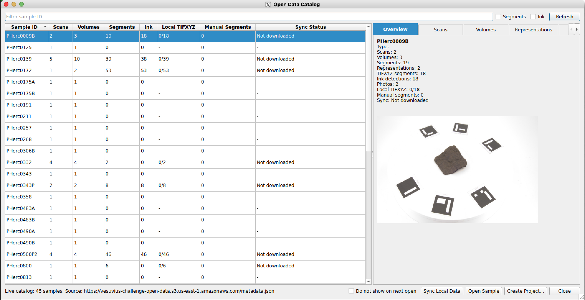
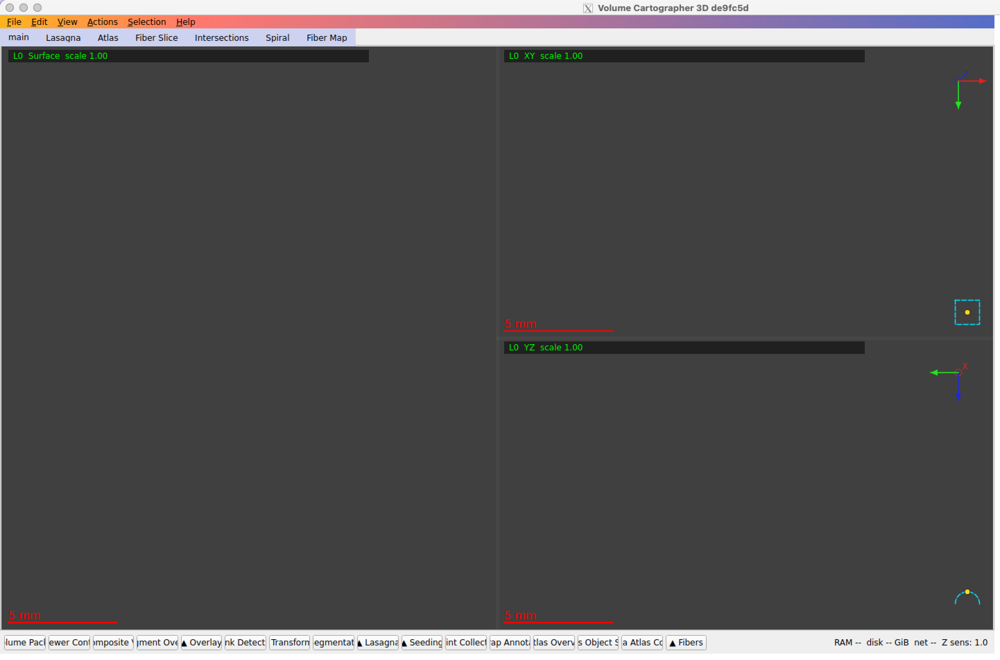

# VC3D on an Intel Mac

Run **VC3D (Volume Cartographer 3D)**, the [Vesuvius Challenge](https://scrollprize.org) segmentation and annotation viewer, on an **Intel (x86_64) Mac**.

VC3D's official macOS builds are Apple Silicon only, and the official Docker image (`ghcr.io/scrollprize/villa/volume-cartographer:edge`) has not been rebuilt since May 2026 (see [villa#1588](https://github.com/ScrollPrize/villa/issues/1588)). This repo takes the **current official Linux x86_64 AppImage** from the [villa releases](https://github.com/ScrollPrize/villa/releases), wraps it in a small Ubuntu 24.04 container, and shows the GUI on your Mac through **XQuartz**. Nothing is emulated: the Mac, Docker and the AppImage are all x86_64.



## Tested on

| | |
|---|---|
| Mac | MacBook Pro 15" 2018 (MacBookPro15,1), Intel Core i7-8750H, 16 GB RAM |
| macOS | 15.7.9 Sequoia |
| Docker Desktop | 4.96.1 (Intel), engine 29.9.2, 8 GB RAM assigned |
| XQuartz | 2.8.1 |
| VC3D | AppImages `de9fc5d` (2026-10-21) and `322cb08` (2026-10-24), linux-x86_64 |

Result: Open Data Catalog loads the live sample list from the public bucket, samples open from S3, pan/zoom is smooth. Image size ~1 GB, build ~1.5 min, VC3D uses ~0.9 GB RAM at start (plus the chunk cache you allow).

## Setup (about 15 minutes, once)

### 1. Install Docker Desktop and XQuartz

- Docker Desktop for **Mac with Intel chip**: <https://docs.docker.com/desktop/setup/install/mac-install/>
  In *Settings → Resources* give it about half your RAM (8 GB on a 16 GB Mac).
- XQuartz: <https://www.xquartz.org> or `brew install --cask xquartz`

### 2. Let XQuartz accept the container

1. XQuartz → **Settings → Security** → tick **"Allow connections from network clients"**.
2. Quit XQuartz (**⌘Q**), then **log out and back in** (needed the first time).

`run-vc3d.sh` checks this setting and runs `xhost +localhost` for you on every start, so only connections coming from your own machine are allowed.

### 3. Get the AppImage and build the image

```bash
git clone https://github.com/antonietox/vc3d-intel-mac && cd vc3d-intel-mac
./fetch-appimage.sh              # newest Linux x86_64 AppImage from villa releases (~125 MB)
docker build -t vc3d-intel-mac .
./run-vc3d.sh list               # should print ~50 vc_* tools
```

To update VC3D later, run `./fetch-appimage.sh` and `docker build -t vc3d-intel-mac .` again.

## Use

```bash
./run-vc3d.sh
```

The **Open Data Catalog** opens. Pick a sample (e.g. type `1447`, select **PHerc1447**) and press **Open Sample**. Data streams from the public S3 bucket; nothing large is downloaded up front. Quitting VC3D stops and removes the container.



| Option | Default | Meaning |
|---|---|---|
| `VC3D_CACHE_GB` | `3` | Chunk cache in GB. VC3D's own default is 10 GB, which can get the container killed on a 16 GB Mac. Use `2` on 8 GB Macs. |
| `VC3D_DATA` | `~/vc3d-data` | Mac folder visible inside VC3D as `/data` (for local segments, exports). |
| `VC3D_IMAGE` | `vc3d-intel-mac` | Image name, if you built it under another tag. |

Settings and the remote-chunk cache live in the Docker volume `vc3d-home` and survive restarts. Check its size with `docker system df -v | grep vc3d-home`; delete it with `docker volume rm vc3d-home` (it is re-downloadable data).

The command-line tools work too, no XQuartz needed:

```bash
./run-vc3d.sh vc_render_tifxyz --help
```

## Troubleshooting

| Symptom | Fix |
|---|---|
| `could not connect to display` / `cannot open display` | XQuartz setting from step 2 missing, or XQuartz not restarted after ticking it. Log out/in once. |
| Container exits silently while browsing | Most likely out of memory: lower `VC3D_CACHE_GB` or give Docker more RAM. Check `docker events` / Docker Desktop's container log. |
| `Too many open files` | Keep the `--ulimit nofile` line in `run-vc3d.sh`. |
| Panel tab labels at the bottom are cut off (`lume Pacl`, `ewer Con`…) | Cosmetic, from Qt font metrics under XQuartz. Widen the window or hover the tabs. |
| `[lasagna] avahi client error: Daemon not running` in the log | Harmless (network service discovery, not needed). |
| `macOS screencapture` shows only the wallpaper | The terminal running it lacks Screen Recording permission; XQuartz windows are fine. |

## What did *not* work (so you don't have to try)

- **Official `:edge` / `:main` Docker image**: runs on Intel, but it is the May 2026 build (no Open Data Catalog, known wrong results per villa#1588).
- **colima with `--vm-type vz`** on this Intel Mac: the VM hung at EFI boot with an empty serial log.
- **colima with `--vm-type qemu`**: needs a current qemu; Homebrew had no prebuilt Intel bottle, so it would be a long source build.
- **Disk images on an HFS+ external drive**: HFS+ has no sparse files, so a "60 GB" VM disk really takes 60 GB. Keep VM disks on APFS or size them small.

## Notes

- The data used here is the Vesuvius Challenge open data (CC BY-NC 4.0). Respect the challenge's [rules and data terms](https://scrollprize.org/faq), in particular about publishing revealed text or ink.
- VC3D itself is part of [ScrollPrize/villa](https://github.com/ScrollPrize/villa) and keeps its own license (GPL-3.0); this repo does not include or modify it, it only downloads the official release. The scripts and Dockerfile here are MIT.

## Credits

Written and tested by Michele Brusemini. Built and tested with help from an AI assistant.

## License

MIT, see [LICENSE](LICENSE).
