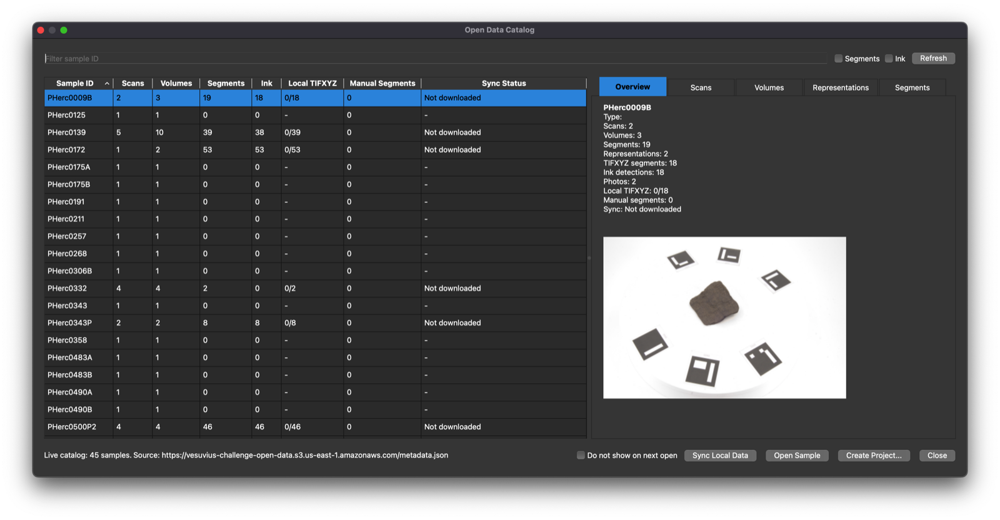
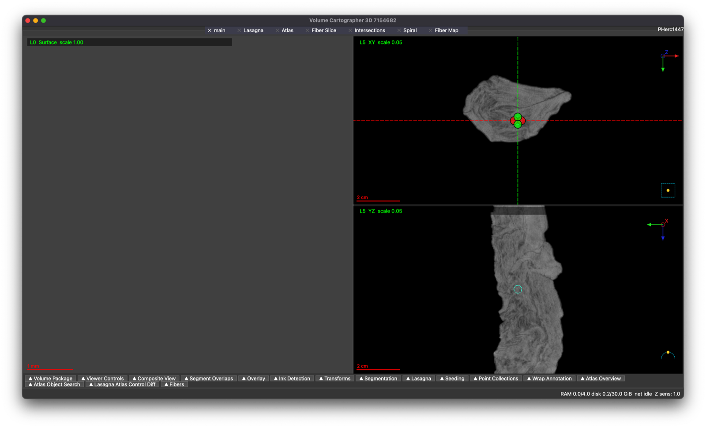

# VC3D for Intel Macs

A **native** build of **VC3D (Volume Cartographer 3D)**, the [Vesuvius Challenge](https://scrollprize.org) segmentation and annotation viewer, for **Intel (x86_64) Macs**, packaged as a normal drag-to-Applications DMG.

VC3D's official macOS builds are Apple Silicon only. This repo builds the current [villa](https://github.com/ScrollPrize/villa) source on an Intel Mac and packages it with villa's own `MacPackaging.cmake`. No Docker, no XQuartz, no emulation. A [GitHub Actions workflow](.github/workflows/build-dmg.yml) rebuilds it on GitHub's Intel runner.



## Install

1. Download `VC3D-…-macos-x86_64.dmg` from [Releases](../../releases).
2. Open it and drag **VC3D** into **Applications**.
3. First launch: the app is ad-hoc signed, not notarized, so macOS blocks it once.
   - Double-click VC3D, close the warning, then go to **System Settings → Privacy & Security** and click **Open Anyway**.
   - Or, in Terminal: `xattr -dr com.apple.quarantine /Applications/VC3D.app`

The **Open Data Catalog** opens. Type a sample ID (e.g. `1447`), select it and press **Open Sample**. Data streams from the public S3 bucket.



The command-line tools (`vc_render_tifxyz`, `vc_grow_seg_from_seed`, `flatboi`, …) are inside the app:

```bash
/Applications/VC3D.app/Contents/MacOS/vc_render_tifxyz --help
```

### Requirements

- Intel Mac with **AVX2** (Haswell, 2013, or newer)
- **macOS 13.3** (Ventura) or newer

### Settings worth knowing (VC3D → Settings)

- **RAM cache size:** this build defaults to a third of your RAM (2–10 GB; 5 GB on a 16 GB Mac). Upstream always uses 10 GB.
- **Remote cache path:** downloaded chunks go to `~/.VC3D/remote_cache` by default. If your internal disk is small, point it to an external drive and set a maximum size. Restart VC3D after changing it. macOS then asks once whether VC3D may access files on a removable volume: click **Allow**.

## What this build adds

Compared with the official macOS build (which only exists for Apple Silicon):

| | Official (`build_macos.sh`) | This build |
|---|---|---|
| CPU | arm64 | **x86_64** (`-march=x86-64-v3`) |
| Multithreading in VC3D's own code | OpenMP replaced by a no-op shim on Clang: 112 parallel regions run on one core | **Real OpenMP** (`libomp`), all cores |
| Panel buttons at the bottom of the window | squeezed into the status bar; labels clipped on 13–15" screens | **own row that wraps**; full labels |
| Default RAM cache | 10 GB | a third of installed RAM (2–10 GB) |
| `flatboi` | built | built (PaStiX, Scotch, OpenBLAS from conda-forge) |
| Dependencies | Homebrew | conda-forge (`environment.yml`) |
| Compiler | Homebrew LLVM + lld | conda-forge clang 21 + ld64, gfortran 16 |
| `LSMinimumSystemVersion` | build host's macOS | 13.3 (what the dependencies need) |
| DMG contents | `VC3D.app` + loose `bin/` | `VC3D.app`, license, notice, source pointer |

### Speed

`vc_render_tifxyz`, one PHerc0500P2 segment, 16 slices at 1800×2340, chunks already in the local cache (external USB SSD), three runs each:

| | Wall time |
|---|---|
| OpenMP shim (as in the official macOS build) | 21.5 / 20.7 / 19.2 s |
| This build (OpenMP, `libomp` blocktime 0) | 20.5 / 15.7 / 15.3 s |

About 25% faster for the same CPU time. This render is mostly bound by reading chunks; compute-heavier paths (segment growth, normal grids) have more parallel work but were not benchmarked here. Idle `libomp` workers are told to sleep immediately, since spinning tripled CPU time without speeding anything up; set `KMP_BLOCKTIME` to override.

## Tested on

| | |
|---|---|
| Mac | MacBook Pro 15" 2018 (MacBookPro15,1), Intel Core i7-8750H (6 cores / 12 threads), 16 GB RAM |
| macOS | 15.7.9 Sequoia |
| VC3D | villa `7154682` (2026-10-28) |

Open Data Catalog loads the live sample list; PHerc1447 opens from S3; pan and zoom are smooth.

## Build it yourself

About 50 minutes on the test machine (≈6 min environment, ≈35 min compile, ≈5 min packaging). Needs Xcode Command Line Tools (`xcode-select --install`) and ~7 GB of disk.

**Why not villa's `build_macos.sh`?** It works on Intel in principle, but it takes every dependency from Homebrew, and Homebrew no longer ships Intel bottles: LLVM, Flang, Qt, OpenCV, Boost and GCC would all compile from source (10+ hours). conda-forge still publishes current `osx-64` binaries, so this build uses them.

```bash
git clone https://github.com/antonietox/vc3d-intel-mac && cd vc3d-intel-mac

# 1. micromamba + build environment (≈2.5 GB, conda-forge only)
curl -Ls https://micro.mamba.pm/api/micromamba/osx-64/latest | tar -xj bin/micromamba
MAMBA_ROOT_PREFIX=$PWD/mamba ./bin/micromamba create -y -p $PWD/env -f environment.yml

# 2. villa source (only the folders VC3D needs) + this repo's patch
git clone --depth 1 --filter=blob:none --sparse https://github.com/ScrollPrize/villa.git
git -C villa sparse-checkout set volume-cartographer vc_object_store
git -C villa apply ../patches/intel-mac-conda.patch

# 3. configure, compile, package
JOBS=6 ./build-vc3d-native.sh all
# → dist/VC3D-<commit>-<date>-macos-x86_64.dmg
```

`JOBS=6` keeps a 16 GB machine responsive; raise it if you have more RAM.

### Automatic builds

[`.github/workflows/build-dmg.yml`](.github/workflows/build-dmg.yml) runs on GitHub's `macos-15-intel` runner (free for public repos; GitHub keeps Intel macOS runners until fall 2027). Every Monday it builds villa `main` and publishes a release if that commit hasn't been released yet. **Actions → Build VC3D DMG (Intel) → Run workflow** builds any villa ref on demand.

### What the patch changes

`patches/intel-mac-conda.patch`, against villa `volume-cartographer/`:

- **Packaging (needed on Intel):** skips the per-file signature of the main `VC3D` executable, which the bundle-level signature covers anyway. On x86_64 the linker doesn't ad-hoc sign the `vc_*` tools (arm64's does), so signing `VC3D` first fails with "code object is not signed at all". Also adds `VC_MACOS_MIN_VERSION_OVERRIDE`.
- **Build:** a `VC_CLANG_OPENMP` option that uses real OpenMP with Clang (plus `core/src/OpenMPDefaults.cpp` for the blocktime), and a guard for `OpenMP::` alias targets a conda dependency already defines.
- **UI:** `FlowLayout` for the panel bar (`StatusDockPanelHost`), kept in its own row instead of the status bar.
- **Defaults:** `SystemMemory` helper; the RAM cache default follows installed memory.

### Known issues

- `libopencv` on conda-forge doesn't pin its abseil version; `environment.yml` pins it (see the comment there).

## Previous version

Until October 2026 this repo ran the Linux AppImage in Docker + XQuartz. That approach is in the git history (`77e9ff5`) if you need it.

## License

- **Scripts and docs in this repo:** MIT ([LICENSE](LICENSE)).
- **VC3D (the app in the DMG):** GPL-3.0, © EduceLab and the Vesuvius Challenge contributors ([LICENSE-VC3D](LICENSE-VC3D), [NOTICE-VC3D](NOTICE-VC3D)). The corresponding source is [villa](https://github.com/ScrollPrize/villa) at the commit named in each release, plus [`patches/intel-mac-conda.patch`](patches/intel-mac-conda.patch). The DMG carries the same license, notice and source pointer.
- **Bundled libraries** (Qt, OpenCV, Boost, Ceres, CGAL, PaStiX, …) come from [conda-forge](https://conda-forge.org) or upstream and keep their own licenses.

Written and tested by Michele Brusemini, with help from an AI assistant.
